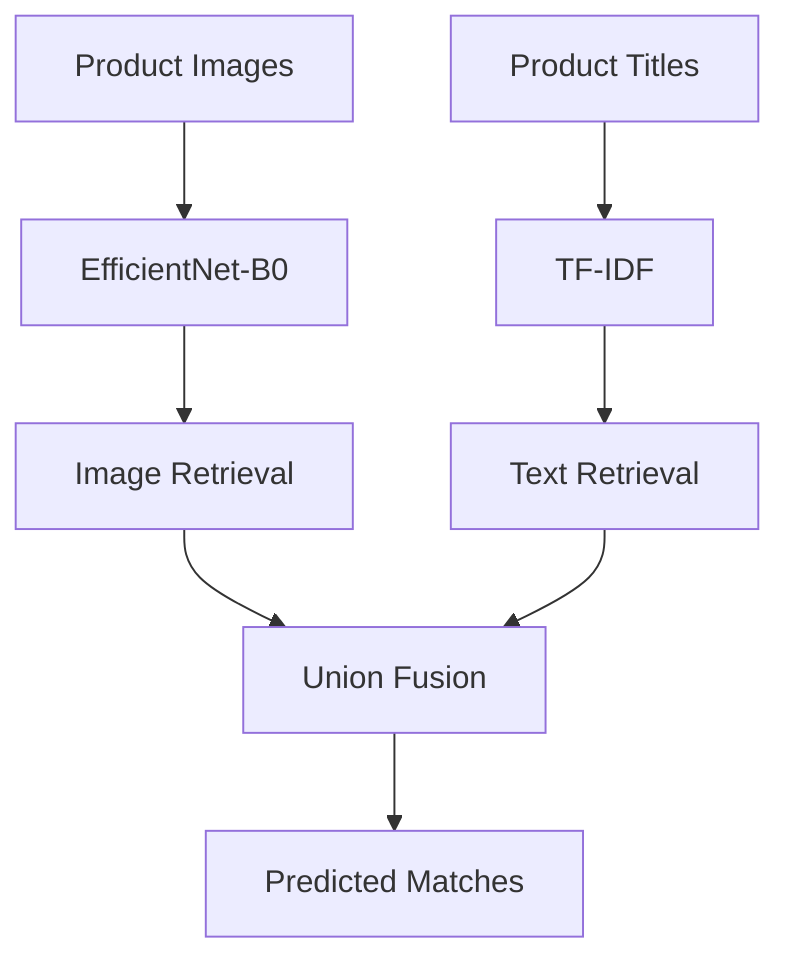

# Shopee Product Matching

A multimodal product matching project based on the Kaggle [Shopee — Price Match Guarantee](https://www.kaggle.com/competitions/shopee-product-matching) competition.

The goal is to find duplicate product listings using images and product titles.

This project focuses on building a retrieval system, understanding its mistakes, and testing ways to improve matching quality.

## Baseline Architecture

The current baseline uses two independent retrieval methods:

- **Image:** Pretrained EfficientNet-B0 as a frozen feature extractor.
- **Text:** TF-IDF with word-level unigrams and bigrams.
- **Retrieval:** Cosine distance and threshold filtering.
- **Fusion:** Union of image and text matches.

The baseline uses an image distance threshold of **0.16** and a text distance threshold of **0.28**.

## Results

### Ablation Study

| Approach | Mean F1 |
|---|---:|
| Image-only | 0.6704 |
| Text-only | 0.5948 |
| **Multimodal (Union)** | **0.7283** |

Combining image and text predictions improves the baseline compared to using either modality alone.

### Cross-Validation

**5-Fold Group CV: 0.7371 ± 0.0074**

Groups are split by `label_group` to avoid sharing product groups between training and validation.

*The initial validation and cross-validation use different gallery configurations, so their scores are not directly comparable.*

## Key Findings

We analyzed additional matches found by TF-IDF but missed by EfficientNet.

Out of 7,828 additional query–candidate pairs:

- **4,256** were correct matches (TP).
- **3,572** were incorrect matches (FP).

The analysis showed that:

- TF-IDF can find correct matches even when product images look very different, but similar titles can also produce false positives.
- EfficientNet sometimes misses correct matches because their image distances are above the selected threshold.
- Correct pairs generally have smaller image and text distances than incorrect pairs, but their distributions overlap.

These results suggest that both modalities provide useful information. In future experiments, we can test whether using both distances together improves matching quality.

## Notebooks

- [Hash Baseline](notebooks/baseline.ipynb)
- [EfficientNet-B0 Embeddings](notebooks/efficientnet_b0_embeddings.ipynb)
- [Multimodal Baseline & Cross-Validation](notebooks/multimodal_baseline.ipynb)
- [Baseline Error Analysis](notebooks/baseline_error_analysis.ipynb)

## Next Steps

- Analyze image retrieval and nearest neighbors.
- Experiment with new pretrained image encoders.
- Improve text embeddings and fusion methods.
- Compare experiments using consistent validation.

---

**Status:** Work in progress — baseline, cross-validation, and initial error analysis completed.